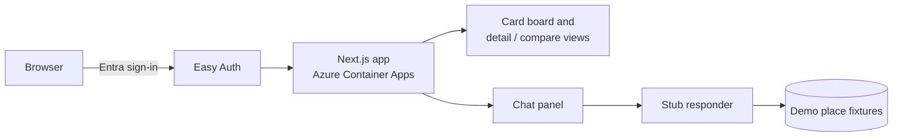

# restaurant-researcher-app

A web interface for the `restaurant-researcher` skill: research a venue by chatting, and compare the results side by side on a card board.

**Status:** The code is public to read. The deployed app is private, behind sign-in, and not publicly accessible. No license is granted: all rights reserved.

<!-- screenshot -->

## What it does

- **Research by chat.** Ask about a restaurant in the chat panel. The app shows progress steps (address and hours, ratings, journey) and adds the place to the board.
- **Card board.** Each place appears as a card with its rating, review count, price tier, opening status, top dishes, a taste-fit score out of 10 and a compact journey summary.
- **Detail view.** Open a card to see the full picture: review quotes (positive and negative), the whole menu with dishes that match your taste marked, the reasoning behind the taste-fit score and any misses, and the full leg-by-leg journey.
- **Compare.** Select two to four cards and compare taste fit, price, rating and journey time in one table.

The current phase is frontend only. Chat replies and place data come from built-in demo fixtures, so the UI can be built and tested before the research agent is connected.

## How it works

The app is a single Next.js page. A chat panel on the right sends a query to a stub responder, which plays a short sequence of progress messages and then looks the place up by name (accent-insensitive) in a set of fixtures. A matching place is added to the board. Selecting cards enables the compare view. A typed `PlaceResult` model (overview, menu, taste fit, journey, optional existing rating) is the contract the real research agent will fill later.

The app runs on Azure Container Apps behind Microsoft Entra Easy Auth: only approved users can reach it, and it scales to zero when idle.

## Tech stack

- **Next.js 16 and React 19:** the app and its UI components.
- **Tailwind CSS 4:** styling.
- **TypeScript:** typed place model shared by the board, cards and views.
- **Vitest and Testing Library:** component and logic tests.
- **Docker and Azure Container Apps:** hosting, with a shared container registry and managed-identity image pulls.
- **Bicep:** infrastructure as code.
- **Microsoft Entra Easy Auth:** sign-in and per-user approval.
- **GitHub Actions:** tests, lint, type-check and build on every pull request.

## Repository layout

- `frontend/`: the Next.js app and its tests.
- `infra/`: Bicep template and deploy script.
- `scripts/`: build, deploy and access-management scripts.

## More

- [Run it locally](docs/development.md)
- [Deployment](deployment/)
