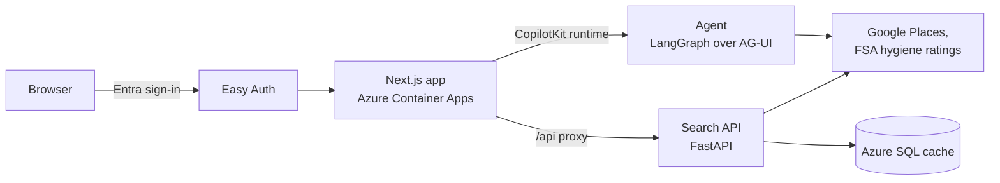

# restaurant-researcher-app

A web interface for the `restaurant-researcher` skill: research a venue by chatting, and compare the results side by side on a card board.

**Status:** The code is public. The deployed app is behind sign-in and not publicly accessible. The search API and agent are built but not deployed yet, so search and the assistant work only locally for now.

<!-- screenshot -->

## What it does

- **Search.** Type what you want ("best ramen near Soho") in the search bar and real London places fill the board in about two seconds, sorted by Google rating.
- **Assistant.** Ask the same in the assistant panel: an AI agent searches, puts the results on the board and can open a place for you. Each answer shows the tools it used. The panel is a column on the right on wide screens and a bottom sheet on phones.
- **Card board.** Each place appears as a photo-led card with its Google rating, the official-style food hygiene rating, price tier and opening status. The fit score, the one-line reason and the route summary arrive in later phases.
- **Detail view.** Open a card to see the full picture: review quotes (positive and negative), the whole menu with dishes that match your taste marked, the reasoning behind the fit score and any misses, and a schematic tube-map style route from Canary Wharf. From there you can open the rating sheet to score a visit (dishes, cocktails, vibe, staff, service); saving is a demo for now.
- **Compare.** Select two to four cards and compare taste fit, price, rating and journey time in one table.

## How it works

The Next.js app serves the board and the assistant panel. The search bar calls the search API through a proxy route; the panel talks to the agent through the CopilotKit runtime, and the agent's `show_places` tool fills the same board. Both backend apps run from one image and are reachable only from inside the environment; the web app forwards the signed-in user's identity to them. A typed `PlaceResult` model is the contract between them.

The app runs on Azure Container Apps behind Microsoft Entra Easy Auth: only approved users can reach it, and it scales to zero when idle.

## Tech stack

- **Next.js 16 and React 19:** the app and its UI components.
- **Tailwind CSS 4:** styling.
- **TypeScript:** typed place model shared by the board, cards and views.
- **CopilotKit (AG-UI):** the assistant panel and its runtime.
- **FastAPI, LangGraph and OpenAI:** the search API and the agent.
- **Vitest, Testing Library and Playwright:** component, logic and browser tests, with fake backends.
- **Docker and Azure Container Apps:** hosting, with a shared container registry and managed-identity image pulls.
- **Bicep:** infrastructure as code.
- **Microsoft Entra Easy Auth:** sign-in and per-user approval.
- **GitHub Actions:** tests, lint, type-check and build on every pull request.

## Repository layout

- `frontend/`: the Next.js app and its tests.
- `infra/`: Bicep template and deploy script.
- `scripts/`: build, deploy and access-management scripts.

## More

- [Run it locally](docs/development.md)
- [Deployment](deployment/)
